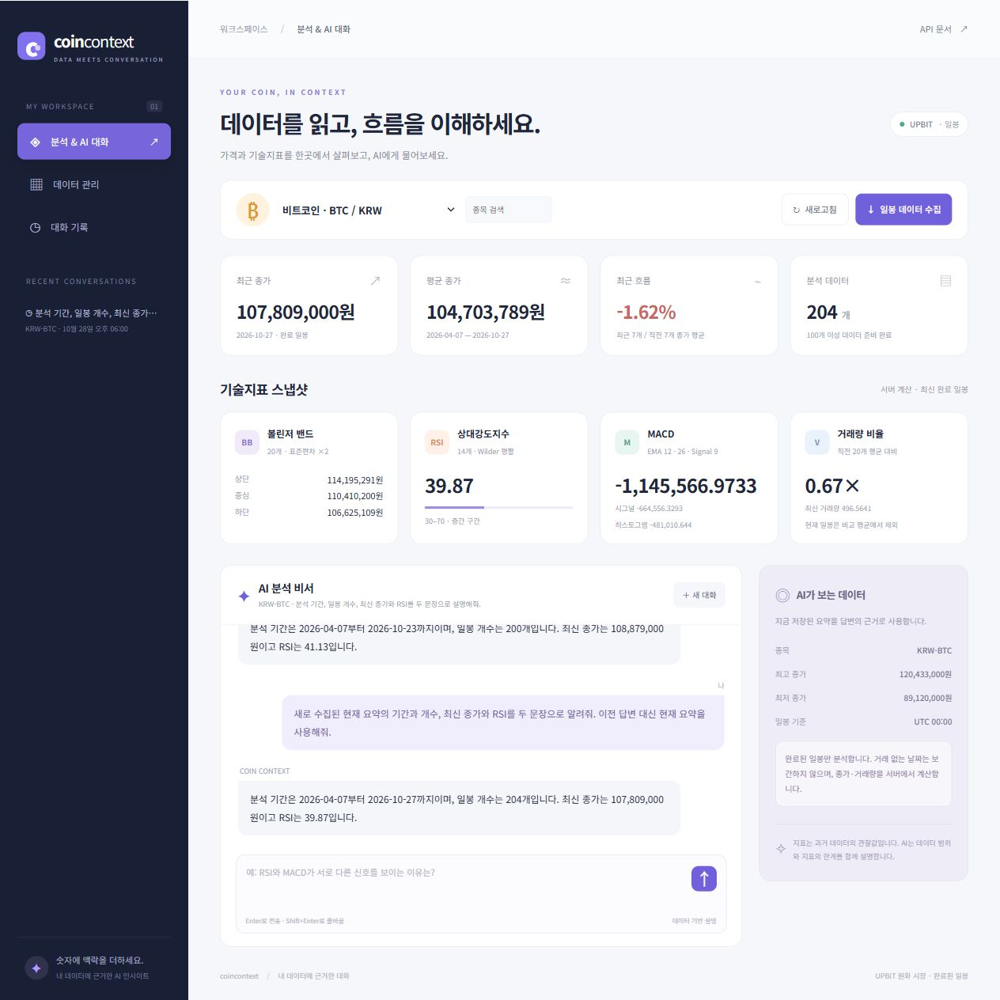

# Coin Context 서비스 결과

선택한 코인의 완료 일봉을 Firestore에 저장하고, 서버에서 계산한 통계와 기술지표를 바탕으로 AI와 대화할 수 있습니다.

| 항목 | 주소 |
| --- | --- |
| 웹 서비스 | [Coin Context](https://m1-2-frontend-topaz.vercel.app/) |
| API 상태 | [Render /health](https://m1-2-j9ok.onrender.com/health) |
| API 문서 | [Swagger](https://m1-2-j9ok.onrender.com/docs) |
| 데이터 요약 | [KRW-BTC 요약](https://m1-2-j9ok.onrender.com/api/data/summary?market=KRW-BTC) |
| 소스 코드 | [GitHub](https://github.com/leeds86/m1-2) |

## 제공 기능

- 업비트 원화 시장 종목 선택과 완료 일봉 수집
- 데이터 추가·조회·수정·삭제와 메모 관리
- 기간별 통계, 볼린저 밴드, RSI, MACD, 거래량 비율
- 계산된 요약을 근거로 하는 AI 질문·응답
- 대화 자동 저장과 기록 불러오기
- 반응형 웹 화면과 공개 API 문서

데이터는 수집 시점의 완료 일봉이며 실시간 시세가 아닙니다. 최신 데이터가 필요하면 **일봉 데이터 수집**을 실행합니다. 첫 접속 시 Render 서버 응답까지 시간이 걸릴 수 있습니다.

구현 구조는 [README](../README.md), 설정은 [배포 구성](setup.md), 확인 범위와 결과는 [검증 결과](verification.md)에 기록합니다.

## 운영 화면

[모바일 화면](screenshots/production-mobile.jpg) · [모바일 입력창](screenshots/production-mobile-form.jpg)
